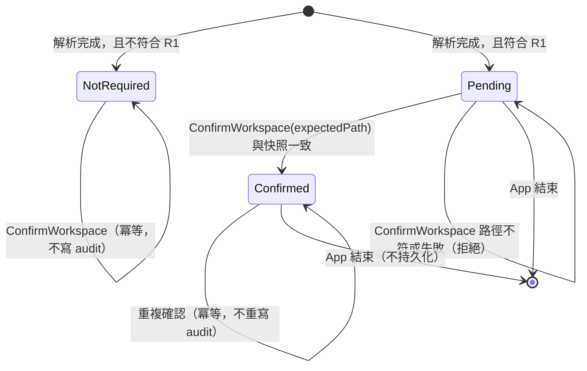
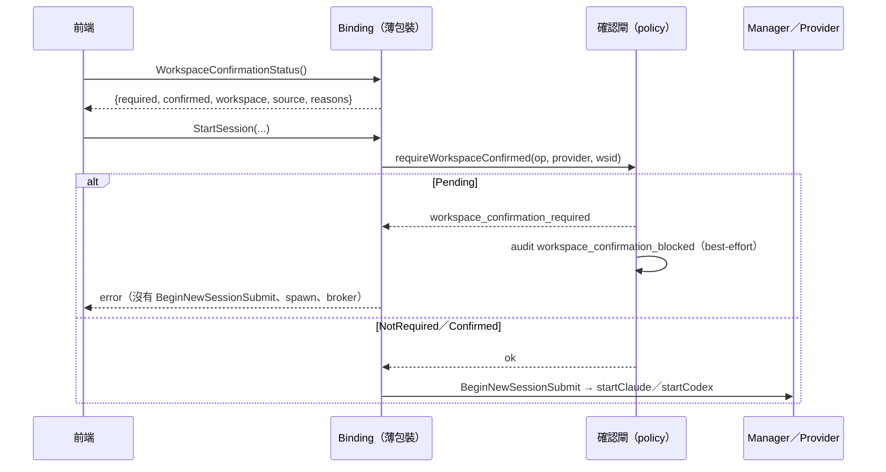
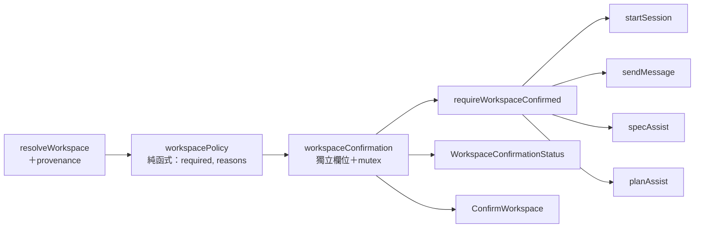

# B4 Workspace 確認閘與高風險警示：設計

> 版本：rev1（2026-10-11，初稿）
> 狀態：**草案，尚未通過 design gate**。待 owner 審閱、codex-reviewer design gate 後，才能撰寫實作計畫。
> 來源：Pre-M4 Readiness Backlog B4（`docs/architecture/pre-m4-readiness-backlog.md` 的「B4 Workspace 明確確認」段）。
> owner 決定（2026-10-11）：
> - 範圍 A：只防「AI 在高風險 workspace 執行工具或改檔」，App 自己的 `.workbench/` 寫入維持現狀，不做啟動時 picker；
> - 觸發條件與確認的生命週期，照 codex-reviewer 設計意見（mailroom #1201）的建議；
> - Spec／Plan Assist 也套用同一個確認政策；
> - audit 沿用 best-effort，不作為放行條件。
> 設計討論紀錄：repo 外 `b3a-evidence/b4/codex-design-001/DESIGN_REVIEW.md`（SHA256 `42ad394f…533b`）。
> 基準：main `facf5df`（tree `6fee1676…`）。下文的 `檔案:行號` 都以這個 tree 為準。

## 1. 目的與範圍

### 1.1 問題

`resolveWorkspace()`（`app.go:3246`）依序嘗試 `env`（`WORKBENCH_WORKSPACE`）→ `cwd`（cwd 不是 `/` 才算）→ `home` → `tmp`，第一個能建立 `<dir>/.workbench` 的就勝出。從 Finder 開啟時 cwd 是 `/`，所以 workspace 會落到家目錄。`env` 無效時則會靜默退回下一個候選。

目前唯一的提醒是頂部列的灰色小字 `ws: <source> @ <path>`（`frontend/src/App.vue:377-380`），README 也只請使用者自己檢查（`README.md:117-126`）。AI 可以在 workspace 執行工具、修改檔案，Codex 的 `approvalPolicy` 甚至可以設成 `never`，所以這不符合 fail-closed 原則。

### 1.2 目標

**在高風險 workspace 上，使用者明確確認之前，不得開始任何 AI 工作。** 「AI 工作」涵蓋：新 session 的首輪、resume、已啟動 session 的後續訊息，以及 Spec／Plan Assist。

### 1.3 非目標（明確不做）

- 不改 App 自己對 workspace 的寫入時機（`.workbench/`、`instance.lock`、audit、registry、evidence 都在使用者看到 UI 之前就建立）。
- 不做啟動時的 workspace picker，也不允許在執行期間更換 workspace。
- 不改 fallback 的順序與目錄：tmp fallback 的 workspace 仍是 `os.TempDir()`，state 仍是 `<tmp>/sdlc-workbench/.workbench`（`app.go:3272-3277`）。
- 確認**不等於**建立檔案沙箱，也不取代既有的逐工具 approval 與 Codex sandbox。
- 不把確認持久化：重啟後要重新確認，不從 audit、registry、resume 或路徑記憶中恢復。
- Codex 登入與帳號狀態查詢（`AuthStatus`、`StartLogin`）不在閘門範圍內（理由與驗證方式見 §5.4）。

## 2. Phase 1：詞彙與例子

### 2.1 詞彙表

| 詞 | 定義 |
|---|---|
| workspace | `resolveWorkspace` 解析出的實際目錄（`a.workspaceDir`），AI CLI 以它作為 cwd |
| source | 勝出的候選來源：`env`／`cwd`／`home`／`tmp` |
| provenance（來源紀錄） | 解析過程的附帶事實：`envSet`（env 是否非空）、`envRejected`（env 是否被拒）及拒絕原因分類、`isHome`（實際 workspace 是否就是家目錄）、`homeIdentityKnown`（家目錄身分能否判定） |
| 高風險 workspace | 符合 §4 Rule R1 任一條件的 workspace |
| 確認 | 使用者對「這次 App 執行期間，在這個實際目錄進行 AI 工作」的明確同意；只存在記憶體中 |
| AI 工作入口 | `startSession`、`sendMessage`、`specAssist`、`planAssist` 這四個內部實作 |
| 閘門 | 四個 AI 工作入口共用的政策檢查函式；未確認時拒絕，而且不產生 session 或 provider 的啟動副作用 |

### 2.2 例子清單（每一條都對應 §4 的 Example）

1. 從 Finder 開啟：source=`home` → 顯示高風險警示；第一次送出訊息被拒；確認後可以正常開始。
2. `WORKBENCH_WORKSPACE=/proj`（有效）→ 不需確認，行為與現在相同（E2E 與 CI 的路徑）。
3. `WORKBENCH_WORKSPACE=/nope`（無效），從終端機在 `/work/repo` 啟動 → source=`cwd`，但 `envRejected=true`，需要確認，警示中顯示退回的原因。
4. `WORKBENCH_WORKSPACE=$HOME` → source=`env`，但 `isHome=true`，需要確認。
5. 在終端機的家目錄 `cd ~` 後啟動 → source=`cwd`、`isHome=true`，需要確認。
6. `WORKBENCH_WORKSPACE=/link`，而 `/link` 是指向家目錄的 symlink → 解析後的實際目錄就是家目錄，需要確認。
7. `WORKBENCH_WORKSPACE=~/projects/foo` → 雖然位於家目錄底下，但不是家目錄本身，不需確認。
8. 所有候選都失敗，退回 tmp → source=`tmp`，需要確認。
9. 未確認時，對已啟動的 session 呼叫 `SendMessage` → 被拒（一般情況下不會發生，因為 session 無法在未確認時啟動；這裡是防禦）。
10. 未確認時呼叫 `SpecAssist`／`PlanAssist` → 被拒，不會啟動 runner 或 preflight。
11. 前端顯示的路徑與後端快照不一致時，呼叫 `ConfirmWorkspace` → 被拒，狀態維持未確認。
12. 確認之後重啟 App → 回到未確認。
13. 家目錄身分無法判定（例如 `os.UserHomeDir` 或 stat 失敗）→ 視為需要確認。

## 3. Phase 2：領域模型

### 3.1 確認狀態機（單一 App instance）

只有 `NotRequired` 與 `Confirmed` 兩個狀態可以通過閘門。

### 3.2 閘門序列（以首輪送出訊息為例）

### 3.3 元件邊界

- `workspacePolicy` 是純函式，輸入是 source 與 provenance，輸出是 `required` 與原因清單，可以單獨做單元測試。
- 確認狀態**不放進** `startupState`（避免動到 `CLIInfo` 形狀與欄位枚舉守門，見 `app_binding_surface_test.go:1007`、`:1170`）。

## 4. Phase 3：規格（Feature > Rule > Example）

Feature：高風險 workspace 必須先經使用者確認，才能開始 AI 工作。

### Rule R1：高風險判定

- **Pre**：`resolveWorkspace` 已經完成，provenance 也已記錄。
- **Post**：下列任一成立時 `required=true`，`reasons` 列出所有成立的項目：
  - (a) `source ∈ {home, tmp}`；
  - (b) `envSet && envRejected`；
  - (c) `isHome`：實際 workspace 與 `os.UserHomeDir()` 經 `os.Stat` 後 `os.SameFile` 成立，不論 source；
  - (d) `!homeIdentityKnown`：家目錄或 workspace 的身分無法判定。
- **Invariant**：家目錄底下的子目錄不會因為路徑字串的前綴相同而被判成 (c)，判定一律以目錄身分為準。
- Examples：§2.2 的 1～8、13。

### Rule R2：閘門

- **Pre**：AI 工作入口被呼叫，而且已經通過既有的 `beginTxn` 與 `registryUncertain` 檢查。
- **Post（拒絕時）**：
  - 回傳的 error 以 `workspace_confirmation_required` 開頭；
  - 不呼叫 `BeginNewSessionSubmit`／`BeginSubmit`；
  - 不 spawn CLI 或 app-server；
  - 不建立 broker、socket、MCP config、recorder、host；
  - 不送 `thread/start`、`turn/start`；
  - Manager 的 submit 狀態不變；
  - 唯一允許的副作用是一筆 `workspace_confirmation_blocked` audit，加上交易計數。
- **Post（通過時）**：行為與現在完全相同。
- **Invariant**：閘門不改變 App 的 lifecycle phase，所以未確認時，`WorkspaceConfirmationStatus` 與 `ConfirmWorkspace` 仍然可以呼叫。
- Examples：§2.2 的 1、9、10。另外，不論 claude 或 codex、首輪或 resume、`approvalPolicy` 是 `untrusted` 還是 `never`，都要被拒。

### Rule R3：確認

- **Pre**：App 處於 ready 狀態；呼叫者傳入 `expectedPath`，也就是前端顯示給使用者的實際目錄。
- **Post（成功）**：
  - `expectedPath` 與後端快照的 workspace 字串完全相同時，狀態從 `Pending` 變成 `Confirmed`，並寫一筆 `workspace_confirmed` audit（best-effort）；
  - 在 `Confirmed` 狀態下重複確認，結果相同，**不會**再寫 audit；
  - 在 `NotRequired` 狀態下呼叫，回傳成功，不寫 audit。
- **Post（拒絕）**：路徑不符或狀態查詢失敗時回傳 error，狀態維持不變，也**不**寫成功 audit。
- **Invariant**：`ConfirmWorkspace` 不能設定或更改 workspace，也不接受由前端提供的 confirmed、reason 等欄位。
- Examples：§2.2 的 11、12。

### Rule R4：生命週期

- **Invariant**：
  - 確認只存在於這一次 App instance 的記憶體中；
  - 重啟後依 R1 重新判定，不從 audit、registry、resume 或任何檔案恢復；
  - 同一個 App 內的所有 session 與 Assist 共用同一個確認。

### Rule R5：前端呈現

- **Post**：
  - `required && !confirmed` 時，頂部列顯示高風險警示：使用 `--err` 樣式並設 `role="alert"`，內容包含實際目錄、source 與原因，並提供「確認在此目錄進行 AI 工作」按鈕；
  - 送出訊息與 Assist 的操作在此期間停用。
- **Invariant**：
  - 查詢或確認失敗時，前端不會放行；
  - 元件重新掛載時不會自動確認；
  - 晚到的舊回應不會覆蓋較新的狀態（沿用 `refreshCliInfo` 的 request sequencing）；
  - 即使前端被繞過，後端的 R2 仍然生效。

## 5. 元件設計

### 5.1 resolver 與 provenance

- `resolveWorkspace` 改成回傳一個結構，包含原本的 `workspace`、`state`、`source`、`err`，再加上 provenance：`envSet`、`envRejected`、`envRejectReason`（有限分類：`normalize_failed`／`mkdir_failed`）、`isHome`、`homeIdentityKnown`。
- 原有的呼叫點（`acquireStateLease`，`app.go:2108-2111`）與「取鎖前只允許空的 state dir 加上鎖檔」的契約維持不變。provenance 的判定只做 `os.Stat`，**不新增任何寫入**。
- `isHome` 的判定方式：先取 `os.UserHomeDir()`，對它和解析後的 workspace 各做一次 `os.Stat`，再用 `os.SameFile` 比較。任何一步失敗時，`homeIdentityKnown=false`。
- 為了讓測試可以控制，resolver 的環境輸入（env、cwd、home、tmp，以及建立目錄的函式）透過一個小型 seam 注入。production 使用真實實作；測試使用隔離目錄，不碰真實的家目錄，也不依賴 chmod。

### 5.2 確認狀態

- 在 App 上新增一個獨立欄位 `workspaceConfirm`（含自己的 mutex），內容是：policy 結果、狀態（`NotRequired`／`Pending`／`Confirmed`），以及對應的 workspace 快照。
- 寫入時機：與 `publishWorkspace` 相同（`app.go:1424-1426`），在 workspace 決定的當下就計算好 policy。
- 新欄位要納入適用的 lifecycle 測試。

### 5.3 Binding

| Binding | 回傳 | 規則 |
|---|---|---|
| `WorkspaceConfirmationStatus()` | `{required, confirmed, workspace, source, reasons[]}` | 薄包裝 `beginTxn → defer endTxn → impl`；**不**加入 startup-safe 白名單；不寫 audit |
| `ConfirmWorkspace(expectedPath string)` | `error` | 薄包裝；依 R3 處理 |

- 兩者都必須通過 `app_binding_surface_test.go` 的薄包裝結構測試。
- `frontend/wailsjs` 的產生檔以 `wails generate module` 重新產生後提交，做法比照 A5：只提交內容差異，權限副作用要還原。

### 5.4 閘門放置

| 入口 | 放置位置 | 備註 |
|---|---|---|
| `startSession`（`app.go:6946`） | `registryUncertain` 檢查之後、`BeginNewSessionSubmit`（`:6962`）之前 | 失敗時不需要 `RejectSubmit` |
| `sendMessage`（`app.go:7026`） | `resolveWSID` 之後、兩個 `BeginSubmit`（`:7033`、`:7047`）之前 | 防禦性檢查：一般情況下，未確認時不會有 active session |
| `specAssist`（`app.go:6318`） | `knownProvider` 檢查與取得 root context 之後，在任何 runner、preflight、spawn 或寫檔之前 | 必須符合 `TestAssistImplementationsTakeRootContextFirst`，以及「gen 先於 txn 進入 assistActive」的 reclaim 順序；實作計畫要逐行標出確切位置 |
| `planAssist`（`app.go:6506`） | 取得 root context 之後、`ensureGate()` 之前 | 同上 |

- Codex 登入（`AuthStatus` `app.go:8890`、`StartLogin` `:8923`）只送出 `account/read`、`account/login/start`，沒有 prompt，也沒有 `turn/start`，因此不在閘門範圍內。但 app-server 仍會以 workspace 作為 cwd 被啟動（`app.go:8086`），CLI 本身初始化時的寫入行為**未驗證**。實作階段要用 fake app-server 測試確認：登入與狀態查詢不會建立 thread 或 turn。若 owner 之後要求連這種啟動也要禁止，那是另一個邊界，需要另外決定。

### 5.5 稽核

- `workspace_confirmed`：記錄 `{workspace, source, reasons}`。只在 `Pending → Confirmed` 時寫一次。
- `workspace_confirmation_blocked`：記錄 `{workspace, source, reasons, op, provider?, wsid?}`。每一次真正被拒絕的 AI 工作請求寫一筆，不包含 prompt。
- 兩者都沿用現有的 `a.audit`（`app.go:3448`）。它忽略寫入錯誤，屬於 best-effort，所以**不保證確認紀錄一定會被持久保存**，audit 寫入成功也不是放行的條件。
- 查詢 status 不寫 audit。
- 既有的 startup audit 不變，所以 `evaluate-e2e-evidence.mjs` 與 B3b L1 的 `workspace_source=env` 契約都不受影響。

### 5.6 前端

- 在 `App.vue` 頂部列新增警示區塊，或抽成一個小元件（實作計畫決定）；樣式使用 `--err`。
- 資料取得順序：先等 CLIInfo ready（沿用現有的 request sequencing），再查詢 `WorkspaceConfirmationStatus`。
- 確認按鈕呼叫 `ConfirmWorkspace(status.workspace)`，成功後重新查詢 status。
- `stores/session.ts` 的 `submit()`、Spec／Plan Assist 的觸發點，在 `required && !confirmed` 時停用，並顯示原因。
- i18n：`zh-TW.ts` 與 `en.ts` 同時新增 key，並通過 parity、keyRefs 等守門測試。
- 頂部列的 `ws:` 顯示維持不變。

### 5.7 文件

- `README.md:117-126`（第一次使用）：補充高風險 workspace 會出現警示與確認流程。
- `README.md:530`（環境變數表）：補上 tmp fallback，以及「env 無效時會靜默退回下一個候選，並觸發確認」。
- backlog：關票時更新 B4 狀態。

## 6. 測試計畫

### 6.1 Go

- **policy（純函式）**：R1 的 (a)～(d) 各一個正例，加上家目錄子目錄的反例；多個原因同時成立時，原因要全部列出。
- **resolver**（透過 seam，在隔離目錄執行）：
  - home、tmp、env 正常；
  - env 無效時，分別退回 cwd、home、tmp；
  - `env=$HOME`、`cwd=$HOME`；
  - symlink 指向家目錄；
  - 家目錄底下的專案子目錄；
  - 家目錄身分無法判定。
- **閘門**：
  - 四個入口在 `Pending` 時都會拒絕：claude 與 codex、首輪與 resume、`approvalPolicy=never` 各自涵蓋；
  - 斷言拒絕時沒有任何啟動副作用：Manager 沒有 Begin、沒有 host、broker、MCP config、recorder，也沒有 thread／turn（使用 fake provider 或 recorder 計數）；
  - `NotRequired` 與 `Confirmed` 的行為和現在相同。
- **確認**：
  - 路徑不符會被拒；
  - 重複確認冪等，audit 只寫一筆；
  - 並行的 Confirm 與 StartSession 不產生競態（需要 `-race`）；
  - 多個 session 共用同一個確認；
  - 新的 App instance 會回到 `Pending`；
  - shutdown 或尚未 ready 時，binding 的行為與既有的 lifecycle 規則一致。
- **binding surface**：兩個新 binding 都符合薄包裝結構；都不在 startup-safe 白名單內；`CLIInfo` 的形狀不變。
- **Codex 登入**：用 fake app-server 驗證 `AuthStatus`、`StartLogin` 不會送出 `thread/start`、`turn/start`。
- **既有測試**：`TestProductionResolverCreatesOnlyEmptyStateDirBeforeLease`、`TestNoWriterOpensBeforeLeaseIsAcquired`，以及 CLIInfo 系列測試，都必須不修改就能通過。若必須修改，要先停下來回報。

### 6.2 前端（vitest）

- 警示的渲染：包含實際目錄、source、原因，以及 `role="alert"`。
- 確認流程：成功、失敗、取消。
- 晚到的舊回應不會覆蓋新狀態；元件重新掛載時不會自動確認。
- `required && !confirmed` 時，送出與 Assist 都被停用。
- i18n 的守門測試都通過。

### 6.3 E2E

- 既有用 env 注入的 E2E 與 B3b 證據契約都不需修改（env 有效且不是家目錄時，狀態是 `NotRequired`）。
- 新增一個反例：用 env 指向家目錄的隔離替身目錄，斷言會出現警示，而且送出訊息會被拒。這項是否放進 E2E，或改由單元與整合測試涵蓋，由實作計畫決定。

## 7. 相容性與風險

- **binding 介面**：新增兩個 binding，必須同步更新 `frontend/wailsjs` 的產生檔、前端的 adapter 與 mock。不修改既有 binding。
- **與 B3b-ready 的衝突**：兩者都會改 `app.go`、`App.vue`、`wailsjs`。B3b-ready 目前沒有在進行，所以 B4 先完成。
- **行為改變（使用者可見）**：從 Finder 開啟的使用者，第一次送出訊息前必須先確認，這是本票刻意造成的改變。`wails dev` 與從專案目錄啟動的流程不受影響。
- **`sendMessage` 的閘門是防禦性的**：一般情況下，active session 一定是在確認之後才建立。如果未來支援 restore 時自動啟動 host，這道閘門就是最後一道保護。

## 8. 估點

| 項目 | 工時 |
|---|---|
| resolver provenance＋seam＋policy | 2 hr |
| 確認狀態＋兩個 binding＋surface 測試＋wailsjs | 1.5 hr |
| 四個入口的閘門＋無副作用測試 | 2.5 hr |
| audit＋Codex 登入驗證 | 1 hr |
| 前端警示、確認、停用、i18n＋vitest | 2 hr |
| README＋backlog | 0.5 hr |
| **合計** | **約 9.5 hr，約 1.0 pt（0.9～1.2）** |

原估 0.6 pt。增加的部分來自：Assist 與 SendMessage 兩個額外入口、副作用測試，以及 Codex 登入驗證。不含等待 review 的時間。

## 9. 待驗證假設

- H1：`os.SameFile` 能正確處理 symlink 指向家目錄的情況（`os.Stat` 會跟隨 symlink）。實作時以測試確認。
- H2：在 `specAssist` 中，閘門可以放在取得 root context 之後、gen 進入 assistActive 之前或之後，而不違反既有的形狀與 reclaim 測試。確切位置由實作計畫讀程式碼後決定；若做不到，要先停下來回報。
- H3：fake app-server 能觀察到登入流程送出的所有 method，以確認沒有 `thread/start`、`turn/start`。
- H4：`a.audit` 在拒絕路徑中被呼叫，不會造成額外的副作用或鎖順序問題。
